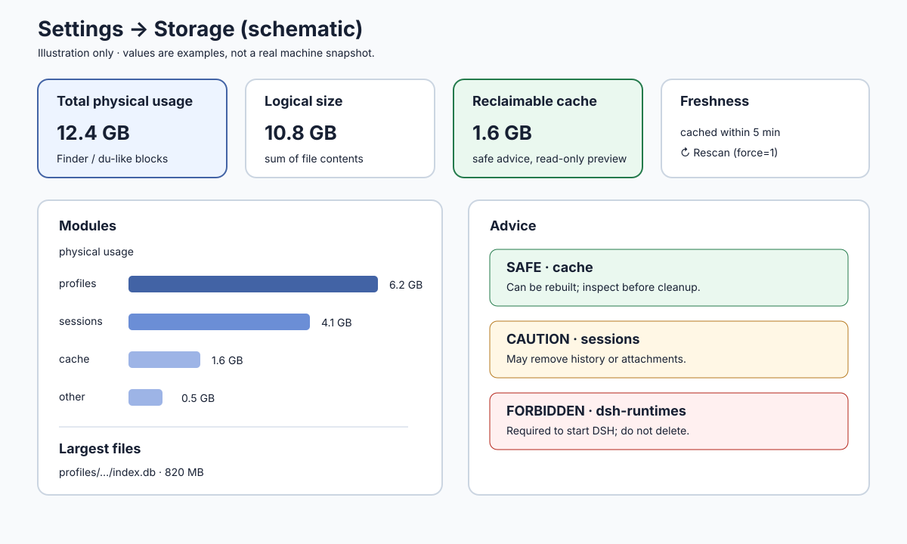
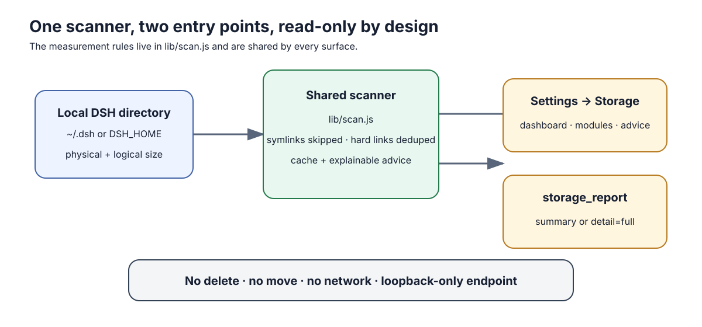
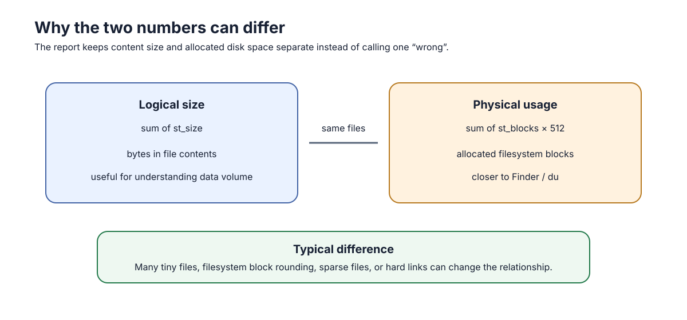

# dsh-storage-inspector

> **给 DSH 做一次安全的本地存储体检。** 看清 `~/.dsh` 哪些模块占空间、最大的文件在哪里、哪些内容可以回收，以及为什么不能随便删。

[](./test)
[](./LICENSE)
[](#安全与隐私)

> 当前版本是 **V1 / 只读版**。它不会删除、移动或上传任何文件；自动清理功能尚未开启。

## 目录

- [它解决什么问题](#它解决什么问题)
- [功能概览](#功能概览)
- [工作原理](#工作原理)
- [安全与隐私](#安全与隐私)
- [数据口径](#数据口径)
- [安装](#安装)
- [使用](#使用)
- [开发与测试](#开发与测试)
- [故障排查](#故障排查)
- [版本计划](#版本计划)
- [贡献与发布](#贡献与发布)

## 它解决什么问题

DSH 的运行时、会话、缓存、插件和日志都可能积累在 `~/.dsh`。只看目录列表很难回答三个问题：

1. **到底占了多少磁盘？** Finder、`du` 和文件逻辑大小可能会给出不同答案；
2. **空间花在哪里？** 需要按模块、缓存和最大文件定位；
3. **什么能动、什么不能动？** 运行时目录和活动配置不能因为“看起来很大”就删除。

本插件把这些判断集中到一个扫描器中，提供设置页和 Agent 工具两个入口，避免两套口径互相矛盾。

## 功能概览



> 上图是用于解释字段的**界面示意图**，不是某台机器的真实截图；示例数字不代表固定占用。

| 能力 | 说明 |
| --- | --- |
| 设置 → 存储 | 总量、物理/逻辑双口径、模块占用、Top 文件和分级建议 |
| `storage_report` | 在对话中询问 DSH 占用；默认摘要，`detail=full` 返回完整报告 |
| 可解释分类 | 区分 active、cache、runtime、sessions、unknown，并说明建议原因 |
| 安全边界 | 只读、不联网、不跟随符号链接、硬链接去重、loopback 接口 |
| 统一口径 | 设置页和 Agent 工具共同使用 `lib/scan.js` |

## 工作原理



扫描流程是：

1. 读取 `DSH_HOME`，未设置时使用 `~/.dsh`；
2. 遍历目录并计算物理块大小与逻辑大小；
3. 跳过符号链接，按 inode 对硬链接去重，遇到权限错误则跳过并继续；
4. 识别模块、缓存和禁止触碰的运行时目录；
5. 生成 Top 文件与“可回收 / 谨慎处理 / 禁止”的解释性建议；
6. 将同一份报告提供给设置页和 `storage_report`。

## 安全与隐私

- **只读**：V1 不删除、不移动、不改名、不写入扫描目录；
- **本地**：只读取 DSH 目录，默认 `~/.dsh`，也可由 `DSH_HOME` 指定；
- **不联网**：扫描器没有上传路径、文件名或报告的网络逻辑；
- **不跟随符号链接**：避免意外越界扫描其他目录；
- **权限最小化**：权限拒绝的条目会跳过，不通过提权绕过；
- **loopback 栅栏**：设置页接口只接受本机 loopback 请求，并拒绝反向代理头与跨站请求；
- **运行时保护**：`dsh-runtimes/` 标记为“禁止”，因为其中包含 DSH 自带的 Node/Python/pnpm；
- **会话边界**：`sessions/` 只显示体积，不提供第二套删除入口，避免绕过会话归档工具；
- **依赖隔离**：包不声明任何 `@deepseek-ai/*` 运行时依赖，避免 `link:` 安装时解析出第二份核心实例。

## 数据口径



设置页主数字使用**物理块大小**：

```text
physical bytes = st_blocks × 512
logical bytes  = 所有文件 st_size 之和
```

物理口径更接近 macOS Finder / `du` 实际占用；逻辑口径更接近文件内容总和。两者不同是正常现象，尤其是大量小文件会产生块分配放大。报告会同时展示两种口径，不把差异伪装成扫描错误。

## 兼容性与限制

| 项目 | 当前支持/默认值 |
| --- | --- |
| DSH | `>=0.2.1-rc.3`（由 `package.json` 声明） |
| Node.js | `>=20` |
| 平台 | macOS 本机路径已覆盖测试；其他平台需自行验证文件系统块口径 |
| 扫描范围 | 仅 DSH 根目录；不会扫描工作区、项目目录或系统其他路径 |
| 缓存 | 默认 5 分钟（`cacheTtlMs=300000`） |
| 超时 | 默认 10 秒（`timeoutMs=10000`）；超时会返回已扫描部分并标记不完整 |
| 权限错误 | 跳过无法读取的条目，`complete=false` 且 `totals.skipped` 增加 |

缓存命中时，设置页的“重新扫描”会通过 `force=1` 绕过缓存。根级 fingerprint 能快速识别常见变化；深层文件变化仍由 TTL 兜底，因此需要最新结果时请手动重新扫描。

当报告的 `complete` 为 `false` 时，数字是**部分结果**，不能当作完整磁盘盘点；设置页会显示“扫描超时/部分结果”提示。

## 安装

### 快速开始

1. 确认 DSH 与 Node.js 版本符合上表；
2. 从 npm 安装：

   ```bash
   dsh plugin --profile desktop add dsh-storage-inspector
   ```

3. 重启 DSH；
4. 新建一个会话，询问“DSH 占多少空间？”验证 `storage_report`；
5. 打开 **设置 → 存储** 查看图形化报告。

### 从源码安装（开发 / 自用）

在插件目录的上一级项目中执行：

```bash
dsh plugin --profile desktop add \
  "link:/absolute/path/to/DSH存储管理插件/2_dsh-storage-inspector"
```

然后重启 DSH。没有启用 HMR 时，修改代码也需要重启才能加载新模块。

卸载：

```bash
dsh plugin --profile desktop remove dsh-storage-inspector
```

> 当前阶段坚持“测试先行、明确授权后安装”。不要在未经使用者授权的情况下改写 desktop profile。

### 从 GitHub 获取

```bash
git clone https://github.com/OnebugIS/dsh-storage-inspector.git
cd dsh-storage-inspector
# 再使用上面的 link: 安装命令
```

### 从 npm 安装

正式发布后，推荐使用：

```bash
dsh plugin --profile desktop add dsh-storage-inspector
```

如果 npm 版本尚未同步，可暂时使用上面的 GitHub `link:` 开发安装方式。

## 使用

### 设置页

打开 DSH 的 **设置 → 存储**，可查看：

- 总物理占用与总逻辑大小；
- 各模块占用及分类；
- 最大文件榜；
- 缓存、活动配置、会话和运行时的分级建议；
- 缓存命中与强制刷新状态。

### Agent 工具

在对话中询问：

```text
DSH 占多少空间？
```

模型可以调用摘要：

```json
{
  "name": "storage_report",
  "arguments": { "detail": "summary" }
}
```

需要最大文件榜和完整明细时使用：

```json
{
  "name": "storage_report",
  "arguments": { "detail": "full" }
}
```

`summary` 默认不携带最大文件榜，适合日常对话；`full` 才返回完整明细，避免把大量路径塞进上下文。

## 开发与测试

环境要求：Node.js `>=20`。

```bash
npm test
npm run preflight
npm pack --dry-run
node --check lib/scan.js
node --check lib/index.js
node --check lib/client.js
```

当前测试覆盖：

- **白盒**：fixture、权限、符号链接、硬链接、物理/逻辑口径、模块分级、缓存、建议构造、真实 `~/.dsh` 集成扫描；
- **黑盒**：Host 工具注册契约、HTTP loopback 栅栏、设置页请求与 403 行为、卸载清理、安装后的工具与设置入口；
- **发布预检**：manifest、patch 插入语义、locale、icon、README、运行时文件和核心依赖隔离。

相关维护资料：[上线部署方案](../3_安装/上线部署方案.md)、[测试方案](../3_安装/测试方案.md)、[验证清单](../3_安装/验证清单.md)。

## 故障排查

### 设置页显示“仅本机可用”

这是预期的安全行为。请确认你是从 DSH 本机打开设置页，不要通过反向代理、远程端口转发或跨站 iframe 访问。

### 数字和 Finder / `du` 不一样

先确认比较的是同一口径：插件主数字是物理块大小，同时提供逻辑大小。macOS 文件系统、稀疏文件、硬链接和大量小文件都可能造成差异。

### 修改代码后没有变化

确认插件仍以 `link:` 安装；然后完全重启 DSH。未启用 HMR 时，热替换不会自动加载新模块。

### 想删除 `dsh-runtimes/` 或 `sessions/`

不要直接删除。前者是 DSH 自带运行时，后者由会话归档类工具负责；本插件 V1 只提供观察和解释，不提供删除按钮。

## 版本计划

- **V1（当前）**：只读扫描、双口径、模块占用、Top 文件、可解释建议、设置页 + Agent 工具；
- **V2（计划）**：dry-run 清理预览、白名单、废纸篓、undo 日志；`sessions/` 继续交给专门的会话归档插件；
- **V3（原则）**：不提供直接永久删除。

## 贡献与发布

欢迎提交 Issue / Pull Request。建议先说明：

- 操作系统与 DSH 版本；
- `npm test` 和 `npm run preflight` 结果；
- 复现步骤与期望行为；
- 是否涉及路径、权限、符号链接或硬链接。

提交前请不要上传 `.env`、token、cookie、私钥或真实会话路径。发布前必须通过测试、预检和 `npm pack --dry-run`，并确认 tarball 不含 `node_modules`、敏感信息或工作区绝对路径。

## License

MIT
